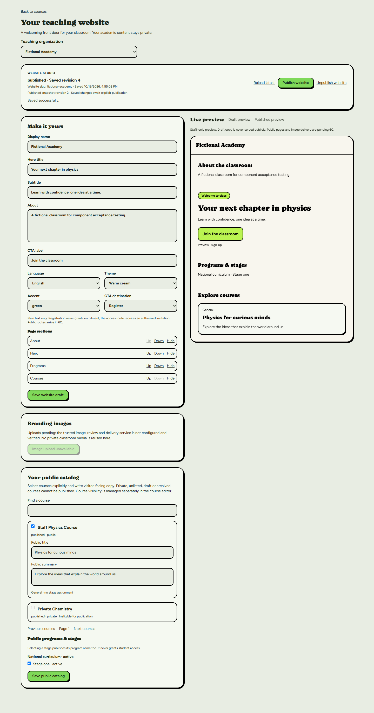
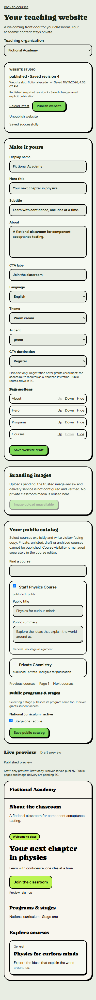
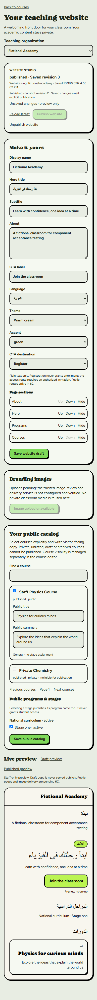

# Milestone 6B — Teacher website studio

Date: 2026-10-19, Africa/Cairo. Branch:
`codex/milestone6-teacher-websites-catalogs`.

This checkpoint implements authenticated website authoring. It does not enable
anonymous application routes, custom-domain routing, DNS, certificate automation
or a trusted image-upload service. The checkpoint commit SHA is provided in the
delivery response; `git log -1 --format=%H -- docs/milestone-6-checkpoint-6b.md`
identifies the commit containing this report without a self-referential hash.

## Source and development database verification

The clean 6A worktree at `b46faff6619e7bb0a664c0e9253a233140c3e231` was fetched
and fast-forwarded to the expected ledger-only commit
`5d2026f61cf2a8c51e76b1a87163b8ab94f73ca8` before implementation. No reset,
rebase, protected-branch change or remote write was performed.

Read-only Supabase checks against development `gmvouqgjbtbkbhrdruzu` confirmed:

- Exactly **31 migrations**, both before implementation and at final recheck.
- Source `20261019004546_teacher_websites_public_catalogs.sql` is applied as
  remote version **20261019132423** with exact stored SQL SHA-256
  **E5588657408C7D56364E59CF7D423FB44AB3DB073931DA7B6A261E3E66149CEC**.
- `teacher_website_command(text,uuid,bigint,jsonb)` is invoker, has an empty
  search path, denies anon EXECUTE and permits authenticated EXECUTE. Its private
  implementation remains the authoritative contextual owner/admin boundary.
- `review_website_resource(text,uuid,bigint,boolean,text,jsonb)` denies anon and
  authenticated EXECUTE; trusted service-role execution remains separate.
- Authoring tables retain their authenticated contextual SELECT policies.

All **31 Git migration blobs are unchanged**. No migration was added, replayed,
repaired or applied. The six Git/remote timestamp mappings in the development
ledger remain authoritative. No connected test accounts, websites, academic
records or Storage objects were created or modified.

## Implemented experience

The existing teacher dashboard and course listing link to **Website studio** at
`/teacher/website`. The original student portal, academic program management,
course editor and teacher-domain architecture remain intact. Clerk mode redirects
this new Firebase-only page back to the existing course listing; its API returns
404 outside Firebase mode.

Owners/admins can:

- Create one website for an existing active organization using a unique,
  validated, stable slug. No organization creation is introduced.
- Edit display name, hero title/subtitle, About, CTA label/destination, English or
  Arabic locale, three theme presets and four approved accent presets.
- Arrange, hide and restore supported page sections using keyboard-accessible
  buttons; at least one section remains.
- Save branding drafts and catalog configuration separately, retaining unsaved
  changes to the other portion. Revision and publication state are visible.
- Explicitly publish or unpublish with confirmation. Publishing is disabled for
  unsaved changes, invalid public selections or unresolved optimistic conflicts.
- Recover a 409 without silently overwriting another tab: input stays visible,
  writes stop, and an explicit discard/reload is required.
- Switch organizations with a discard confirmation. The scoped editor remounts,
  aborts its initial request and ignores late responses after unmounting.

Other active organization staff receive read-only authoring/preview data. They
cannot obtain publication rights from course editor or offering assignments.
The API independently rechecks owner/admin membership on every write; the SQL
command revalidates permissions under its existing concurrency locks.

The catalog editor lists actual authorized organization courses and their current
status/visibility, with search and ten-choice UI pages. Selection is explicit.
Public titles and plain-text summaries start empty: internal course titles,
rich-text descriptions, lessons and private media are not automatically copied
into public content. Private, unlisted, draft and archived courses cannot be
newly selected; existing invalid selections remain visible for removal and block
publication. Programs/stages require explicit consent, and archived choices
cannot be added. A course without a selected public stage is shown as General.

Draft preview projects only eligible selected courses and active selected
programs/stages, with blockers explaining omitted choices. Published preview is
loaded through the **actual allowlisted `public_teacher_catalog` projection**,
not reconstructed from private draft data. It follows bounded keyset pages,
rejects version changes/repeated cursors and keeps published copy frozen after
later draft saves. The saved revision and published snapshot revision distinguish
saved changes awaiting publication. Preview CTAs are inert, and clearly labeled.

The UI uses existing V2 typography, green/cream/black tokens, bordered rounded
cards, hard shadows and responsive layouts. Arabic content previews use `lang=ar`
and RTL. The editor's administrative help text remains English; this checkpoint
does not claim a fully translated dashboard.

## API and authorization boundaries

`GET /api/teacher/website?organizationId=<uuid>` and
`POST /api/teacher/website` use the verified Firebase application viewer and
request-scoped Supabase client. Only the narrow new API/page are allowlisted in
Firebase middleware. No wildcard or anonymous dashboard route was introduced.

- Writes require exact configured-origin CSRF checks and reject cross-site
  requests through the existing shared Firebase origin validator.
- Strict Zod discriminated commands permit only create/draft/catalog/publish/
  unpublish. Identity fields, arbitrary website IDs, domain operations, resource
  approval and unknown fields are rejected.
- JSON-only writes, streaming **20,000-byte** request cap, no write query
  parameters, no duplicate read parameters, UUID organization scope and safe
  integer revisions. The database's independent payload limit still applies.
- Caller identity is server-derived; active organization/membership is checked
  before authoring reads. All queries filter by the requested organization and
  retain existing RLS. The RPC, not a service-role client, performs writes.
- Explicit column lists omit rich descriptions, personal/student information,
  private media and resource-review paths. No new private-schema access.
- `private, no-store`, `Vary: Cookie`, sanitized errors and retryable conflicts.
- Database lists use deterministic 200-row range pages instead of a silent
  PostgREST cap. A 10,000-row safety bound per collection fails explicitly.
  Catalog selections retain the database's 200-course/100-stage limits.

Scoped TypeScript additions for the three consumed website tables and two RPCs
are isolated in the server service, extending the generated foundation types.
The existing generated database file and all prior consumers were not rewritten.

## Image upload trust status

**Uploading is explicitly disabled**, in both the displayed capability and UI.
There is no upload, reservation, review, cleanup or public image-delivery HTTP
route. An example service-key variable is not a configured, reviewed trusted
worker, and no privileged credential was requested or exposed to enable this.
No reservation or object can be orphaned by this editor in its current state.

The prepared server-only `normalizeWebsiteImage` boundary is genuinely tested
with image bytes. It:

- Bounds input/output to 2 MiB and input decoding to 16,777,216 pixels.
- Decodes PNG/JPEG/WebP, validates dimensions 16–4096 pixels and rejects
  unsupported formats, multiple pages, malformed bytes and excessive size.
- Applies orientation, outputs normalized WebP without retained EXIF/ICC/XMP,
  and hashes the verified output bytes with SHA-256.

This helper **does not claim trusted approval or Storage delivery**. Before upload
can be enabled, implement/configure a separately reviewed trusted adapter that
reserves using the caller RPC, writes only normalized bytes to the dedicated
private `lms-website-assets` bucket, invokes service-only review with exact output
metadata, and provides scoped rejection/abandonment/revocation cleanup through
the Storage API. Public delivery must recheck the approved published reference;
pending/rejected/revoked objects must never be served. Real Storage tests require
separate owner authorization. Existing academic files cannot be reused as public
branding assets.

## Verification and evidence

| Check | Actual result |
| --- | --- |
| Full application workflow | **286 passing**, 0 failing, including 10 new editor tests |
| Strict non-incremental TypeScript | Passed; an initial real pagination typing error was corrected |
| Architecture boundaries | Passed |
| ESLint | 0 errors; same 10 pre-existing warnings, no new warning |
| Native disposable PostgreSQL replay | All **31 migrations**, upgrade/seed preservation checks passed |
| Existing SQL suites | All **21 passed**, including website 114, academics 101, account 36 assertions |
| Independent-session concurrency | All **104 existing cases passed**, including 8 website races |
| Chromium actual-component desktop/mobile | **11 scenarios passed**, no JavaScript exceptions |
| Production-mode builds | Firebase/Supabase and Clerk/Prisma fallback both passed |
| Actual Firebase production-build anonymous smoke | Health 200, editor API 401, cross-origin write 403, nested unallowlisted route 503; page streams a sign-in redirect without editor data |
| Whitespace and historical SQL checks | Passed; no historical migration diff |

Editor unit tests cover strict/oversized/malformed requests, unauthenticated and
cross-origin denial, organization swapping, owner/admin versus teacher/assistant
rights, sanitized SQL errors, stale revisions, multi-page course reads,
allowlisted published snapshot pagination/version conflicts, public preview
eligibility and real normalized image bytes. Existing website SQL/concurrency
tests exercise draft/public boundaries, tenant and course-editor denial, atomic
publish snapshots, stale publish/unpublish, role revocation after lock waits,
asset trust, domain collisions and isolated tenant editing. SQL and policies were
not changed merely to make UI tests pass.

The actual React/CSS Chromium harness uses **fictional local HTTP state**, not
connected Firebase/Supabase sessions. Its 11 scenarios cover create, catalog
copy/selection persistence, publication isolation, conflicts and explicit
recovery, English/Arabic RTL, ordering, mobile overflow, screenshots, unpublish,
organization switching, read-only staff, failed loading/retry, search/pagination
and keyboard focus. It found accessible-name ambiguity in nested select labels;
explicit accessible labels were added and the complete harness rerun.

An additional task-owned loopback server ran the actual Firebase production
build, without test accounts. Its anonymous editor page returns HTTP 200 with
Next.js's `NEXT_REDIRECT`/refresh instruction to `/sign-in` after streaming starts;
the editor form is absent. The smoke harness initially expected a pre-stream 307
and was corrected to verify the actual redirect instruction and absence of editor
content. The protected JSON API independently returns 401. This is unauthenticated
route verification, not authenticated provider acceptance. The smoke server was
stopped afterward. Both mode builds contain the new route; fallback compilation
does not prove live Clerk sign-in with configured credentials.

These screenshots contain only fictional component-fixture data. They do not
claim a live authenticated teacher session or a deployed public website.

Reproduction: `npm run check`; native SQL via `npm run test:exam-sql:postgres`
with the existing optional PostgreSQL runtime and a task-owned loopback cluster;
component browser test via `node scripts/website-editor-browser-components.cjs`.
The browser harness requires `LMS_BROWSER_RUNTIME` (Playwright node_modules),
optional `LMS_ESBUILD_RUNTIME` (esbuild node_modules), and
`LMS_COMPONENT_FONT_BUILD` (existing Next build for the actual font CSS/assets).
`LMS_CHROMIUM_EXECUTABLE` optionally selects an installed Chromium. No credentials
are needed for this component harness. Local esbuild tooling was installed only
under Git-ignored `.local/`; application dependencies/lockfile are unchanged.

### Test environment limitations and cleanup

The old stopped E: disposable PostgreSQL cluster reported a local filesystem
read error when restarted. It was stopped safely and preserved for diagnostics.
A fresh, uniquely named loopback PostgreSQL cluster on C: completed the entire
replay/regression/concurrency run. No database fault was relabeled as a passing
test. The harness removed its exact random database, verification found **zero
remaining disposable databases**, and the owned cluster was stopped. Local
cluster files/logs remain ignored for diagnostics; no broad deletion was used.

The initial bundled Playwright expected an absent browser revision. Tests were
rerun successfully using installed Chromium 1243. Failed harness processes were
stopped; final browser contexts, browser and local HTTP server close at exit.
No original development app server was stopped or repointed.

Connected authenticated Firebase acceptance, real image upload/review/delete,
anonymous HTTP cache/SEO behavior, Firefox/WebKit, live custom domains and load
testing were **not performed** in 6B. No connected fixture authorization was
granted for this checkpoint; no fictional fixture is presented as provider proof.

## Remaining 6C requirements and release gates

Implement anonymous teacher landing/catalog/detail paths using the allowlisted
public projection, accurate 404s, safe platform-origin CTAs, taxonomy filters,
keyset pagination, robots/canonical/sitemap behavior, rate limiting and safe
no-store caching until reviewed live-visibility invalidation exists. Do not widen
anonymous SELECT on private academic tables. Public paths do not exist yet.

Image delivery/trusted review remains pending as described above. Domain claim
UI, real proof verifier and HTTPS routing belong to 6D; existing Caddy Basic Auth
and DNS are untouched. Combined real-provider acceptance needs separate approval.

No push, PR creation, merge, protected branch modification, deployment or
connected schema/data mutation is part of this checkpoint. `main`, integration
branches, M5 worktree and PRs #14/#15 remain preserved.
