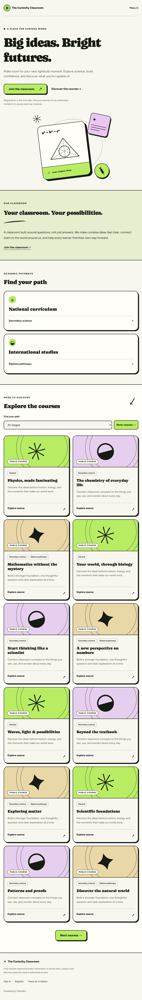
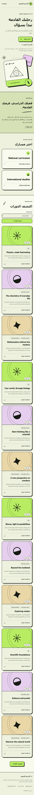

# Milestone 6C — Public teacher websites and course discovery

2026-10-19, Africa/Cairo. Branch: `codex/milestone6-teacher-websites-catalogs`.
Base: preserved local 6B commit `cbdd6a92076c2de57671025ce16db0b9fde3884b`,
which remains ahead of the remote planning/ledger checkpoint `5d2026f`.
No reset, rebase, push, PR, merge or deployment is part of this checkpoint.
The final checkpoint commit is supplied in the delivery response and can be
identified with `git log -1 --format=%H -- docs/milestone-6-checkpoint-6c.md`.

## Implemented public experience

Platform-owned visitor routes:

- `GET/HEAD /t/[slug]`: published teacher landing and course catalog.
- `GET/HEAD /t/[slug]/courses/[courseId]`: approved public course summary.
- `GET/HEAD /t/[slug]/sitemap.xml`: bounded published-site sitemap.

These are anonymous **HTML/XML Route Handlers**, not authenticated dashboard
pages. The application-layer renderer composes the public React presentation with
backend services; no backend module imports frontend code and no architecture
boundary was relaxed. Rendering is buffered before response headers are sent,
so absent/unpublished sites and unavailable courses return genuine HTTP **404**,
not a streamed HTTP 200 with an error screen. Valid provider/gateway failures
return **503**; invalid input **400**; snapshot conflict **409**; invalid authority
**421**; gateway denial **429** with `Retry-After`. Next's generated HEAD handling
retains status/cache headers and omits the body.

This deliberately avoids the root dashboard's authentication providers, account
profile bridges, intro splash, legacy Clerk checks and global loading boundary.
The root layout and private dashboard design were not rewritten. Visitors do
not initialize Firebase or receive identity/session payloads. The pages require
no hydration or client JavaScript: links, GET filters and a native mobile
`details` menu work without scripts. A strict CSP disables scripts and frames.

The full visitor design includes a roomy expressive hero, mathematical CSS/SVG
artwork, About section, academic pathway cards, stage selection, public course
cards, course details, invitation guidance and a teacher-branded footer. It uses
the existing green/cream/black language, hard shadows, rounded borders and
teacher-selected approved theme/accent tokens. This is not the small editor
preview stretched to fill a page. The saved section array controls exact order
and visibility. Hidden hero/About copy is also excluded from metadata fallbacks;
a hidden primary heading uses only the public academy display name.

Fonts are local **Caprasimo and Figtree**, copied byte-for-byte from their already
used Next font artifacts, with SIL OFL notices alongside them under
`public/fonts/teacher-sites/`. There is no Google Fonts browser request or new
image-provider dependency. The actual Arabic text renders with RTL and suitable
system Arabic glyph fallbacks because these Latin font subsets have no Arabic
glyphs. Navigation, empty/error-independent visitor guidance and category labels
are localized; no claim of an Arabic Caprasimo font is made. Error pages remain
English. Motion is disabled for reduced-motion preferences.

## Public data and disclosure boundary

`anonymousCatalogClient()` uses only the configured publishable key, no session,
cookie adapter, Firebase token, `accessToken` callback or service-role credential.
It forces no-store transport and a bounded network timeout. Public reads invoke
**only** `public_teacher_catalog`; they never SELECT academic tables.

The existing SQL remains authoritative for active organization, published
website snapshot, live `courses.status='published'`, `visibility='public'`,
selected active stage/program labels and approved publication facts. Draft,
private, unlisted, archived and inactive-tenant records cannot become public by
guessing a course UUID. Live privacy/status changes are checked on every read;
there is no publication cache to wait for or republish requirement.

Strict projection schemas reject unknown fields. The HTTP adapter additionally
checks requested slug, page bounds, deterministic UUID ordering, uniqueness,
stage relationship integrity and continuation consistency. Only approved public
titles/summaries appear. There are no internal descriptions, lessons, homework,
assessments, attempts, scores, student records, teacher personal data, progress,
private object paths or media URLs in rendered public output.

Query contract for the landing page:

- `stage`: one published stage UUID, optional. The native All stages form's
  deliberate empty string is normalized to omission; other malformed values fail.
- `after`: one UUID keyset cursor, optional.
- `limit`: exactly `6`, `12` or `24`; default `12`.
- Unknown/duplicate parameters are rejected. Detail and sitemap accept no query.
- Slugs are lowercase `[a-z0-9]+(-[a-z0-9]+)*`, length 3–80. Detail IDs must be UUIDs.
- UUID input is normalized to lowercase before comparisons and canonical links;
  uppercase-but-valid UUIDs cannot create spurious response-integrity failures.

The cursor is not an authorization token. A second scoped public course lookup
validates that it still belongs to this site's currently public selection and
stage. A removed/private/wrong-tenant cursor gives a restart-first-page error,
not a misleading empty catalog. A version race gives 409. Stage changes reset
the cursor. General/unassigned courses are shown in All stages and correctly
labeled General; no invented SQL-only General filter or false total is used.
The UI offers next and first-page navigation, not fabricated offset pages.

Programs/stages follow the frozen approved public labels/order, while the SQL's
live archival checks still suppress unavailable classifications. Public course
detail pages contain a teacher-approved summary and safe access guidance;
they do not imply enrolled students can read academic material anonymously.

## Visitor journey, authorities and SEO

All security-sensitive URLs derive from the exact configured **APP_ORIGIN**,
never Host/X-Forwarded-Host. Production requires an exact HTTPS origin without
userinfo, path, query or fragment; development additionally supports loopback
HTTP. Incoming Host must match that origin or an explicitly configured exact
platform-ingress authority. No request header chooses an organization or a
custom-domain binding. Forged Host is rejected; spoofed forwarded authority is
ignored and cannot alter canonicals, CTAs, site selection or redirect targets.

`PUBLIC_WEBSITE_ALLOWED_HOSTS` permits at most five extra exact lowercase ingress
authorities; this is for reviewed platform ingress, **not** teacher domain
activation. There is no wildcard custom-domain routing in 6C.

Sign in/Register use the existing first-party routes with `next=/access`.
The access CTA opens the existing access screen. A public slug never becomes an
invitation, access token, enrollment or membership. The site explicitly tells
visitors to obtain an authorized teacher invitation. No generic self-enrollment,
checkout, payments, new organization or cross-domain auth cookie was introduced.

Every successful HTML response includes a document title, bounded description,
trusted canonical, basic Open Graph metadata, correct language/direction and
robots metadata/header. Filtered/cursor/non-default-size variants are
`noindex, follow` with the clean landing canonical. Error responses are
`noindex, nofollow`. The existing staff editor receives `X-Robots-Tag: noindex,
nofollow` in Firebase mode. No private preview route is exposed publicly.

The per-site sitemap traverses at most four 50-course projection pages (the
approved database maximum is 200 selected courses), rejects snapshot races or
unexpected overflow, and contains only that site's canonical landing/detail
URLs. It does not enumerate all organizations/websites or invent lastmod times.
Private/unpublished courses disappear from each fresh sitemap. XML is escaped.
The XML itself is `noindex`, and may be submitted explicitly to a search engine
after release. A global sitemap/robots website inventory is **not implemented**:
the projection intentionally has no anonymous website-enumeration API. Existing
global robots/Caddy behavior is not modified to invent one.

HTML/XML use `Cache-Control: no-store, max-age=0`, `CDN-Cache-Control: no-store`
and `Vercel-CDN-Cache-Control: no-store`. No framework fetch/revalidation cache or
service-worker cache is added. The templates use React text/attribute escaping,
no raw HTML, JSON-LD interpolation or user CSS. Successful pages set a strict
same-origin stylesheet/font CSP, `base-uri 'none'`, frame denial, nosniff and
no-referrer. Text-only/CSS art is used even when the projection returns an asset
UUID; no Storage path, signed URL, private avatar or academic file is delivered.

## Abuse control and explicit production gates

The HTTP service integrates an **external durable rate-decision gateway** rather
than process-local counters or spoofable IP headers. Required server-only names:

```text
APP_ORIGIN
NEXT_PUBLIC_SUPABASE_URL
NEXT_PUBLIC_SUPABASE_PUBLISHABLE_KEY
PUBLIC_WEBSITE_RATE_LIMIT_URL
PUBLIC_WEBSITE_RATE_LIMIT_TOKEN
PUBLIC_WEBSITE_ALLOWED_HOSTS       # optional exact extra platform ingress hosts
```

No actual environment/deployment configuration was changed; `.env.example`
adds only the three new names with empty values. Its pre-existing Firebase
public API configuration is unchanged; that browser-facing API key is not a
Firebase Admin/service-account credential. No privileged or local secret env
file is included. Requests POST a fixed
global bucket name, validated site slug and bounded cost to the configured HTTPS
endpoint using a private bearer token. A strict decision is
`{allowed:boolean,retryAfterSeconds:integer(1..3600)}`. Gateway requests disallow
redirects, use no-store and time out after three seconds. Denial gives 429;
missing configuration, bad response, network failure or unavailable gateway
fails closed with 503 before public projection reads. No forwarded IP is used
as an enforcement identity. There is no unreviewed production bypass switch.

**The durable enforcement service itself is not provisioned.** Before public
exposure, an approved gateway must atomically consume a global budget and a
per-site budget (including unknown slugs) across all app instances, use bounded
TTL/cardinality, reject unauthorized service callers and be monitored. Initial
review targets are 1,000 global cost units/minute and 60 per site/minute, to be
load-tested/tuned by the owner. Ordinary routes cost 1, cursor pages 2, sitemap 4.
These are an integration contract and proposed starting budgets, not a claim
that a deployed Redis/edge limiter exists. Missing enforcement intentionally
prevents production browsing, while deterministic local fixtures validate the
allowed/denied/failure paths.

**Direct Supabase Data API abuse is a separate mandatory gate.** Anyone with the
publishable key can invoke the already approved public projection directly and
bypass the application's HTTP gateway. Its SQL field/tenant/row bounds preserve
confidentiality, but do not supply a durable network request budget. The owner
must configure and verify provider/API-edge quotas and anti-abuse controls for
direct RPC traffic before anonymous launch, including non-app-origin callers.
Do not claim application throttling closes this bypass or revoke existing
reviewed anonymous grants silently. No provider settings were changed here.

Custom-domain DNS/TLS, Caddy public listeners, staging Basic Auth changes,
trusted asset review/delivery and public launch remain separately approved
6D/6E/infrastructure work. Existing Caddy Basic Auth is unchanged. Static public
CSS/fonts contain no tenant or session data.

## Verification

| Check | Actual result |
| --- | --- |
| Application tests | **298 passed**, 0 failed, including 12 new public-website cases |
| Strict non-incremental TypeScript | Passed |
| Architecture checks | Passed; no rule was widened to allow backend/presentation coupling |
| ESLint | 0 errors; same 10 existing warnings |
| Disposable native PostgreSQL | **31 migrations, 21 suites, 104 concurrency cases passed** |
| Website SQL / preservation | 114 website assertions; M4 account 36 and M5 academic 101 assertions passed; pre-existing tables/data/RLS/functions/grants/policies preserved |
| Both production builds | Firebase/Supabase and Clerk/Prisma fallback passed |
| Local production HTTP + Chromium | **17 scenarios** against actual buffered public routes/UI with fictional outbound catalog/gateway adapter |
| Real connected anonymous Data API | Missing-site RPC HTTP 200/null; private-course direct read HTTP 401; no session or record mutation |
| Historical migration/secret/whitespace review | Existing 31 migrations unchanged; no privileged secrets, local secret environment files or ignored runtime artifacts included; example additions are empty |

The production browser harness is `scripts/public-website-browser.cjs`. It starts
only its own random loopback server, maps a fictional canonical browser host to
that local transport and replaces outbound RPC/gateway fetches in an **ignored
test-process preload**. The production application contains no fixture route,
mock provider switch or sample data. Unexpected outbound requests are blocked
by the harness. Supabase URL/publishable values are build-time public inputs;
the hook intercepts the exact RPC path rather than pretending runtime overrides
replace Next's inlined public variables. Browser fixtures are not evidence of
connected published-site or provider gateway acceptance.

Scenarios cover published/unpublished/missing states, true status codes, malformed
parameters, current course visibility after publication, wrong-tenant course and
cursor denial, Host/forwarded authority attacks, sitemap pagination, gateway and
provider failures, private API/CSRF preservation, noindex preview, script-free
desktop rendering, stage filtering, keyset navigation, course detail/back,
first-party CTAs, tablet/mobile menu and overflow, Arabic RTL, hidden sections
and genuine empty catalogs. HEAD status/cache/body behavior is checked too.
There are no browser JavaScript exceptions. The actual SQL suites independently
test database authorization and frozen publication/draft separation.

Early failures were investigated rather than ignored: existing middleware unit
fixtures needed the new real route-parser dependency; the test HTTP client did
not actually transmit an overridden Host, so a raw HTTP request verified rejection;
a rotated decorative orbit caused mobile overflow and was resized; standalone
error title rendering was changed to one text child. Two Next page-specific lint
rules are locally documented as inapplicable to this standalone HTML document
(head and stylesheet tags); other lint and architecture rules remain enabled.

### Actual visitor screenshots

All screenshots show the real visitor renderer on the actual local Next
production server. Displayed academy/course data and outbound gateway decisions
are fictional, not connected customer/provider acceptance.


[Complete desktop website](evidence/milestone6c/visitor-desktop.png)






Reproduction: `npm run check`; native loopback `npm run test:exam-sql:postgres`
using the existing optional local SQL runtime; `node scripts/public-website-browser.cjs`
after an isolated build matching `.local/m6c-build-firebase` and its local config
hook. The browser harness requires existing `LMS_BROWSER_RUNTIME` and optionally
`LMS_CHROMIUM_EXECUTABLE`; no provider credentials or remote fixtures are needed.
Raw manifests, test hooks, provider checks, logs and builds remain ignored.

## Development preservation, cleanup and remaining acceptance

Read-only checks before/after implementation confirmed development
`gmvouqgjbtbkbhrdruzu` remains at exactly **31 migrations**, M6A remote version
**20261019132423**, SHA-256
**E5588657408C7D56364E59CF7D423FB44AB3DB073931DA7B6A261E3E66149CEC**.
Anonymous core-table SELECT remains denied; anonymous projection EXECUTE remains
enabled as reviewed. No historical migration was replayed/repaired or applied.
No new SQL was required and no connected records or Storage objects were created.

All native SQL work ran in a fresh uniquely named disposable C: PostgreSQL
cluster. Its exact random test database was dropped; verification found zero
remaining test databases and the owned cluster was stopped. Local synthetic
data files/logs are retained ignored for diagnostics. Each browser run closes
its contexts/browser and stops its exact child server on success or failure.
The normal localhost:3000 server and original review demo are untouched.

Remaining release gates: provision/test durable HTTP and direct-Data-API abuse
enforcement; authorize real connected published-site, Firebase visitor/access
journey and trusted Storage testing; implement/review 6D domain routing/DNS/TLS;
perform the combined 6E acceptance and load/cross-browser tests. Firefox/WebKit,
live domains, real email delivery, real Storage delivery and production load
were not tested. No production-launch readiness is claimed from fictional data.

Checkpoint 6C is ready for owner code/visual review within these explicit gates.
Do not push, merge, deploy, enable DNS/Caddy, modify protected branches or start
6D without the next authorization.
