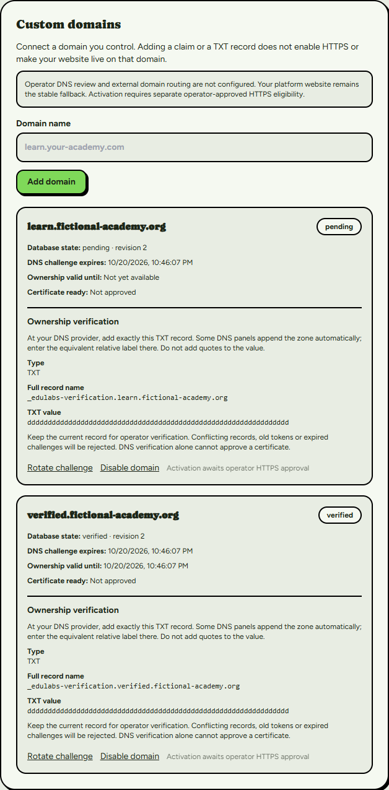
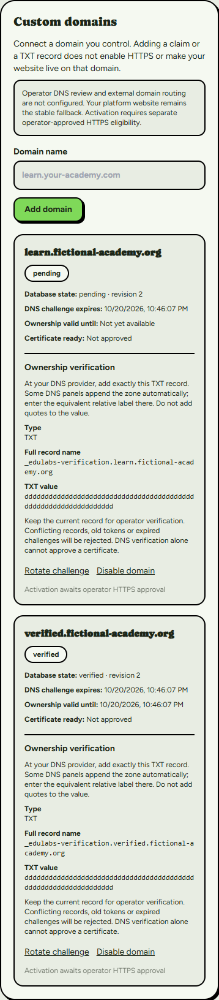

# Milestone 6D — custom domains and secure ingress foundation

Date: 2026-10-19, Africa/Cairo. Branch:
`codex/milestone6-teacher-websites-catalogs`; worktree `E:/EduLabs-Milestone6`.
Base: `26c7cfc93b38dcfa4fd17117f0571a00d1821157` (6C), preserving 6B
`cbdd6a92076c2de57671025ce16db0b9fde3884b` and all earlier milestones.

**Checkpoint 6D local implementation is complete for owner review. No public
custom domains, trusted operator service, HTTPS ingress or limiter service have
been activated. This is not public-launch approval or live-provider acceptance.**

The separate implementation commit containing this report is the 6D checkpoint.
Its exact SHA and clean-tree verification are recorded in the delivery response
and ignored local delivery receipt; resolve it independently with
`git log -1 --format=%H -- docs/milestone-6-checkpoint-6d.md`.
No push, merge, PR change, deployment or protected-branch update is authorized.

## Implemented UI and identity-bound operations

Website Studio now contains a V2-styled responsive Custom Domains panel:

- Owner/admin can claim ASCII domains, read exact current TXT instructions,
  rotate proof with confirmation, and disable a claim with confirmation.
- Pending, verified, active, disabled, revoked and effective expired status are
  distinguished. Stored state/revision, proof expiry, ownership expiry and
  operator certificate eligibility are explicit. Expiry is recomputed while open;
  UI status does not mutate database state or fabricate activation.
- Ten retained bindings include disabled/revoked history. Claims are never deleted
  or silently transferred. Revoked controls are disabled permanently.
- Teacher/assistant sees read-only status; the application omits TXT proof for
  these roles. Proof is ultimately public DNS data, not an authorization credential.
- Invalid/reserved hosts, collisions, data failures and stale revisions return
  actionable sanitized errors. 409 preserves input and requires explicit reload.
  Saving a domain action preserves unrelated unsaved branding/catalog drafts.
- Website creation is required before claiming. Verification and activation are
  visibly unavailable until operator DNS/HTTPS infrastructure is approved.

The existing API accepts only `domain.claim`, `domain.rotate`, `domain.disable`
with strict data shape, identity-derived organization and existing CSRF/session
checks. Both site and domain revisions go to the existing identity-bound RPC;
RLS/SQL remains authoritative. Owner/admin status never becomes a global role.
There is no browser review/certificate/activation API and no privileged key added.
The existing database owner activation RPC remains available only after its
trusted verification/certificate prerequisites; its privileges were not changed.

## Trusted verification and lifecycle

`server/services/domain-verification.ts` implements a tested server-only engine
and injectable existing `review_website_resource` service-only adapter. The
configured entry point is disabled before any DNS/review side effect.

Checks: exact organization/site/id/revision, active organization, canonical
non-reserved ASCII hostname, permitted state and current unexpired 64-hex proof.
It queries only `_edulabs-verification.<hostname>`, using the server's fixed OS DNS
configuration. No user-selected resolver or HTTP fetching is possible. Native DNS
tries once/two seconds; hard deadline is at most three seconds. It bounds record
count, chunks and total bytes, supports split strings, rejects contradictory or
stale TXT, sanitizes NXDOMAIN/transient failures, cancels outstanding resolution,
and re-reads proof/scope before the locked RPC. Receipt includes an operator ticket
and proof digest, and always sets **certificateReady=false**.

The injected operator client does not read/create any service credentials. Its
future authenticated operator, safe loader, audit storage, rate budget and trusted
DNS environment are deployment prerequisites. No live DNS request was made.
Mocked DNS proves algorithm behavior, not domain ownership or DNS propagation.

Existing SQL is deliberately preserved: review of an active binding returns it to
verified; proof expires after 24 hours; ownership review lasts seven days. Rotation
invalidates proof/certificate/active state immediately. Controlled revalidation
therefore requires fresh proof, review, certificate eligibility and reactivation,
with possible downtime. Seamless renewal would need separately approved SQL.
Disabled bindings retain ownership collision protection; revoked claims cannot
be automatically recovered. DNS alone cannot establish functioning HTTPS.

## Host-routing security

`server/services/domain-routing.ts` implements an inactive reusable resolver for a
future isolated public renderer. It is not wired to middleware or any HTTP route.
Its only database lookup is the existing anonymous allowlisted domain projection.
It reuses the 6C public catalog DTO and publication/version validation.

| Threat | Enforced local boundary |
| --- | --- |
| Forged Host/proxy headers | Exact configured transport Host plus constant-time HMAC; client Forwarded/X-Forwarded-Host never chooses tenant |
| Proof tampering/replay | Signed host/method/path/query/time/128-bit nonce; 30-second age, five-second clock skew; mandatory durable atomic nonce port |
| Platform/staging takeover | Fixed provider/platform suffixes plus server-configured reserved hosts/platform origin; canonical ASCII only |
| Private route traversal | Only root and course UUID paths; strict unique query allowlist; APIs/auth/admin/debug/unknown routes denied |
| Cross-tenant catalog | Active binding slug/publication version must match scoped public projection; strict DTO prevents private fields |
| Expiry/revocation/unpublish | Existing SQL lookup rejects them; mapping checked again after projection; changes fail closed |
| Cache/open redirect/canonical leakage | Returns only validated platform public paths and configured HTTPS canonical origin; no arbitrary redirect, cookies or private rewrite |
| Admission outages/alias bypass | Global/domain, per-site and nonce ports mandatory before catalog access; no process-local/unlimited fallback |

Edge SNI equality, gateway authentication/header stripping, real TLS, static asset
routing, HTTP rendering/headers and distributed limiter behavior still require
real integration acceptance. The adapter alone does not prove these external
properties. Missing ingress stays disabled; the stable `/t/[slug]` fallback and
Firebase session boundaries remain unchanged.

Database reservation of every actual platform/staging suffix is a hard activation
gate. Application/verifier guards also reject those configured names, but direct
RPC callers can bypass application validation; do not rely on UI hiding. No
reservation rows or connected domain records were changed during this checkpoint.

## Operations and abuse controls

See [the inactive rollout runbook](milestone-6-domain-operations.md) for exact
TXT/lifecycle/operator steps, OVH/Caddy topology, certificate eligibility versus
issuance, renewal/expiry, signed ingress protocol, failure recovery and rollback.
Current Caddy/Compose and staging Basic Auth are untouched. Stock Caddy cannot
produce this HMAC envelope without a separate reviewed signing component.

6C's external HTTPS rate-decision contract is unchanged and remains fail-closed.
6D requires a shared atomic nonce service plus global/domain and shared per-site
budgets. No limiter service is provisioned. Provider/API-edge enforcement covering
the original Supabase endpoint remains a **hard public-launch blocker**: a WAF
on a custom hostname cannot protect direct anonymous RPC traffic at supabase.co.
Safe DTO/RLS grants protect confidentiality, not request costs. A provider-native
control or separately approved Data API pre-request limiter must be independently
verified before launch; no permission or schema change was slipped into 6D.

## Actual validation

All results below concern this local checkpoint. Logs and raw fixtures remain
Git-ignored under `.local/`; screenshots contain only fictional domain data.

| Check | Actual result |
| --- | --- |
| Application tests (normal test list, serial concurrency) | **323 passed**, zero failures |
| New domain unit/security tests | **22 passed**; DNS, lifecycle, RPC receipt, signed routing, reserved hosts, replay and budget denial |
| Website editor tests | **13 passed**, including three added domain role/contract/reserved-host cases; included in 323 |
| Architecture boundaries | Passed |
| Strict TypeScript | Passed, `--noEmit --incremental false`; no memory-exhausted result counted as pass |
| Lint | Zero errors; ten pre-existing warnings in unrelated files |
| Native PostgreSQL replay | All **31 migrations**, with preservation assertions for existing data, functions, policies/grants |
| SQL regression suites | All **22 passed**: prior 21 plus domain suite with **23 assertions** |
| Concurrency | Prior **104** cases plus **5 new domain** cases passed (**109 total**) |
| Chromium Website Studio | **18 scenarios**, actual React/CSS/fonts, fictional local HTTP adapter; desktop 1440px/mobile 390px; zero page exceptions/overflow |
| Chromium anonymous production routes | Prior **17 scenarios passed** against current Firebase build; fictional catalog/gateway adapters, desktop/tablet/mobile/Arabic RTL; zero page exceptions |
| Firebase/Supabase production build | Passed with full compile/type/lint/static generation |
| Clerk/Prisma fallback production build | Passed with full compile/type/lint/static generation |
| Git whitespace/migration preservation | `git diff --check` passed; no migration file changes |

New native races: concurrent owner claims/site revision; disable versus stale
trusted review; activation versus stale rotation; revalidation versus stale
activation; committed publication visibility and post-unpublish resolver denial.
The prior cross-tenant hostname-claim/rotation/role-revocation races also passed.
A native pg bigint-to-JSON test-fixture mismatch was fixed locally before the final
successful run; no SQL was changed to accommodate a test. Unit tests also caught
and fixed a malformed-input Zod refinement exception; invalid input now yields a
normal validation failure. No outstanding test failure is being hidden.

Reproduction uses the normal `npm run check` steps, serialized test execution to
bound RAM, and `npm run test:exam-sql:postgres` with the existing optional native
PostgreSQL runtime. Browser component runner is
`scripts/website-editor-browser-components.cjs`, with
`LMS_EDITOR_EVIDENCE_DIR=.local/m6d-editor-browser`, existing Playwright/esbuild
runtime/font-build paths and installed Chromium executable. The existing public
browser harness was run from an ignored copy changing only checkpoint build names
from m6c/M6C to m6d/M6D, so it tested the newly built application. Both builds used
ignored isolated output/config hooks and read existing local configuration without
copying secrets. No tracked tsconfig/Next/deployment settings were edited.

## Screenshots

Actual Website Studio component and existing V2 styles; **fictional HTTP data,
not a real domain, DNS or Firebase/Supabase acceptance claim**.





## Development database and preservation

Read-only pre/post checks confirmed development `gmvouqgjbtbkbhrdruzu` still has
exactly **31 applied migrations**. M6A remote version: **20261019132423**.
Git file: `supabase/migrations/20261019004546_teacher_websites_public_catalogs.sql`.
Both reviewed local SQL and remotely stored SQL SHA-256:

```
E5588657408C7D56364E59CF7D423FB44AB3DB073931DA7B6A261E3E66149CEC
```

No new migration is required. All existing migrations and historical timestamp
mappings are preserved; no db push, replay, history repair or connected mutation.
Read-only effective privileges: anon/authenticated cannot execute trusted review;
service_role can; anon can resolve the allowlisted binding but cannot SELECT the
domain table. Authenticated SELECT remains subject to existing staff-scoped RLS.
No private academic table was opened anonymously and organization self-provisioning
remains revoked. Full local authorization/Firebase/enrollment regressions passed.

No connected fixtures, Firebase identities, Storage objects, DNS entries or
certificates were created, so no remote deletion was needed. Native tests used a
new uniquely owned loopback C: PostgreSQL cluster and random database. The exact
test database was dropped; independent verification found zero remaining test
databases; that cluster was stopped. Ignored diagnostic files remain locally.
Browser contexts and exact task-owned local servers were stopped after tests;
existing port-3000/demo servers were untouched. No credentials were committed or
copied into evidence; local artifacts stay ignored.

## Remaining 6E work and release gates

1. Owner reviews this checkpoint. No push/merge/deploy occurs automatically.
2. Obtain separate authorization for real connected account/site/Storage journeys
   and combined M4–M6 authenticated release acceptance. None were performed in 6D.
3. Configure trusted operator authentication/service credentials, safe loaders,
   audit and DNS resolver; reserve actual platform/staging names in the database.
4. Independently implement/verify durable admission and original-Data-API cost
   protection; measure cross-instance, alias, restart, outage and load behavior.
5. Approve isolated gateway/renderer/assets/CSP/HTTPS integration; then authorize
   real DNS/certificate/Caddy operations. Preserve staging Basic Auth.
6. Run real external HTTPS/SNI, certificate renewal/expiry, domain removal,
   session/cookie isolation and public-media acceptance. Firefox/WebKit and real
   provider/load/cost tests remain unexecuted. Email delivery remains a separate gate.

No owner decision is needed to finish these local 6D changes. External activation,
credentials and any seamless-renewal SQL change need separate review/authorization.
