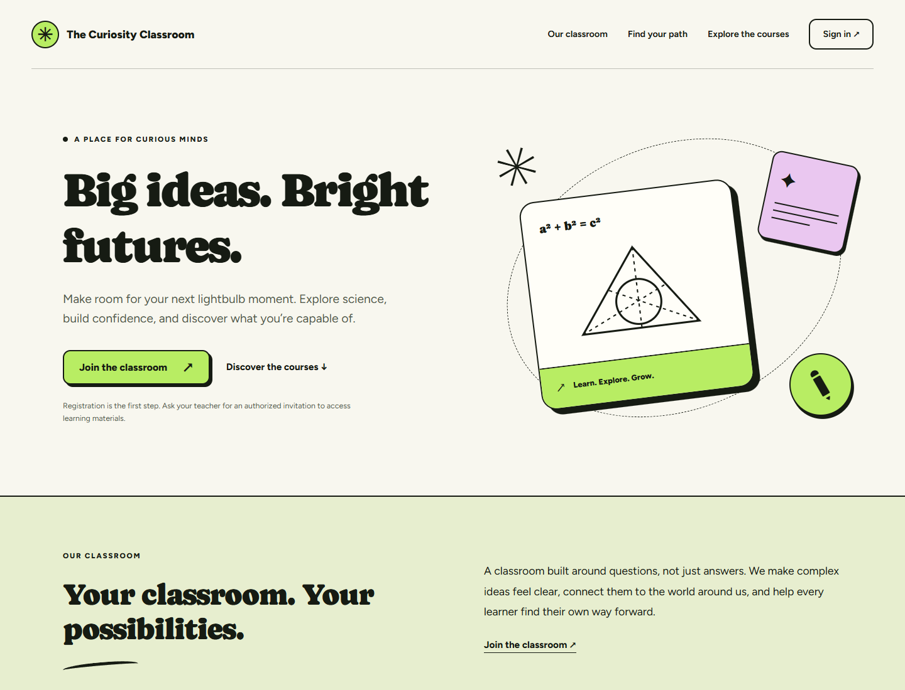
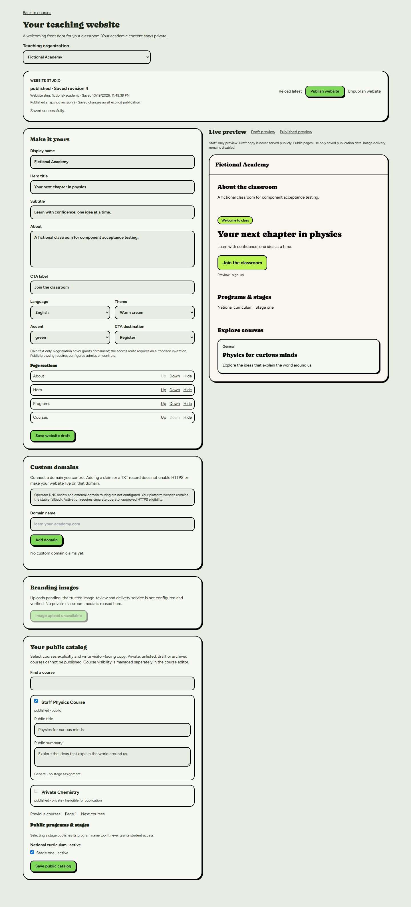
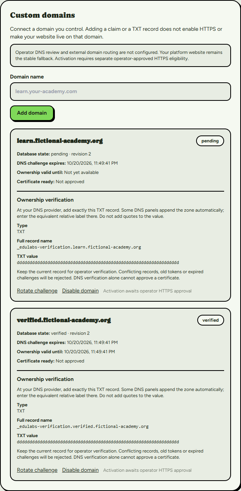

# Milestone 6E — integrated release candidate

2026-10-19, Africa/Cairo. Repository: `EduLabs-LMS/EduLabs-LMS`.
Branch/worktree: `codex/milestone6-teacher-websites-catalogs`,
`E:/EduLabs-Milestone6`.

**Ready for owner code/integration review; PUBLIC LAUNCH BLOCKED.**
Text-based platform teacher websites and the local domain security foundation are
implemented and locally verified. Disabled image delivery and operational custom
hosts are not being presented as fully wired features or provider-accepted flows.
No real authenticated M4–M6 fixture acceptance was authorized/executed in 6E.

Draft PR: [#16](https://github.com/EduLabs-LMS/EduLabs-LMS/pull/16), targeting
`codex/milestone5-academic-programs-stages` at
`75a3a7d291830afc832567fc4f7fe9bac30a057b`.
Stack: **M6 → M5 draft #15 → M4 draft #14 → integration/staging**.
No merge/retarget of dependencies is authorized.

## Exact history and delivery identity

| Checkpoint | Commit |
| --- | --- |
| M5 base, draft #15 | `75a3a7d291830afc832567fc4f7fe9bac30a057b` |
| M6 planning | `a78f6911279b5409f4fe60d3cb9ccb00fc8baf0b` |
| 6A database/security | `b46faff6619e7bb0a664c0e9253a233140c3e231` |
| Applied-DB ledger / previous remote head | `5d2026f61cf2a8c51e76b1a87163b8ab94f73ca8` |
| 6B Website Studio | `cbdd6a92076c2de57671025ce16db0b9fde3884b` |
| 6C anonymous websites/catalog | `26c7cfc93b38dcfa4fd17117f0571a00d1821157` |
| 6D domain foundation | `834f35c3e58fe0478af1dfcb76cf524a3aff31cb` |
| 6E response/render integration fixes | `381c81decc1385e63ece077bfc419f2a3e1da0a8` |
| 6E query/proof-boundary fixes — final executable code | `ea0a6f283681b43db3f92d31d2d40e7d50dea43d` |

The report/evidence-only commit containing this file is the final release-package
HEAD. Its exact SHA is supplied in the delivery response and PR's verified
`head_sha`; obtain it independently with
`git log -1 --format=%H -- docs/milestone-6-checkpoint-6e.md`.
Embedding that commit's own hash in its contents would be self-referential. The
final branch/remote/PR equality and clean-tree receipt is retained ignored under
`.local/m6e-delivery.json`. The executable code tested is identified above.

The initial normal push was verified from remote `5d2026f` to `ea0a6f2`; this
report-only checkpoint is pushed normally afterward. No reset, rebase, amend,
force-push, tag push or other branch push was used. #14 remains draft at
`d264556480d81f64f3c3e5cc6fce84f7c9bbabdb`; #15 remains draft at `75a3a7d`.
The initial #16 code head is mergeable and its Vercel check succeeded. Final
report-head CI status is recorded separately in the handoff; earlier green status
must not be mistaken for a different commit's check or provider acceptance.

## Cumulative source review and focused corrections

Reviewed the complete M5→6D cumulative source and the existing M4/5 reports,
master contract, database ledger, middleware, Caddy/Compose, public routes and
session/academic adapters. Preserved organization/dashboard and multi-curriculum
relationships, enrollment policy, Firebase identity, private academic data and V2
styles. No account/academic service, dependency/lockfile, infrastructure or
production configuration change was introduced by 6E.

Concrete integration fixes, committed separately from checkpoint reports:

1. Gateway response bytes are now bounded during streaming (1 KiB), not only after
   allocating a potentially oversized body. Oversized streams are cancelled and
   sanitized to 503. Null/malformed/failed replies still fail closed.
2. Buffered public rendering is awaited inside the HTTP error boundary. A rejected
   asynchronous render becomes a sanitized no-store 503 rather than escaping it.
3. Only the landing form normalizes `stage=` to All stages. Detail and sitemap
   correctly reject even that empty query; they accept no query fields.
4. Signed ingress rejects the exact 30-second expiry instant and retains consumed
   nonces for 40 seconds from admission, beyond the signature/skew window even
   for near-expired proofs. Durable store enforcement is still mandatory.
5. Removed two stale Studio help messages saying public routes would arrive in 6C.
   No visual layout, animation, logo, typography or authentication redesign.

## Integrated threat review

| Surface | Findings and verification |
| --- | --- |
| Public disclosure | Allowlisted snapshot plus live public/published/active checks; private/unlisted/draft/archived courses excluded; no academic descriptions, lessons/blocks, homework, exams/keys, progress, students, staff personal data or private paths in DTOs. Native SQL plus strict adapter/render tests cover guessed ids and privacy changes. |
| Authentication | Anonymous client uses publishable configuration only, without Firebase cookie/token/provider bridge. Route Handlers bypass the private page layout; real local production HTML has no account providers/session payload or client JS. Website APIs retain Firebase viewer, exact-origin CSRF, bounded payload and contextual SQL authorization. |
| Tenant boundaries | Composite FKs, RLS and identity-bound commands enforce same-org course/stage/asset/site/domain scope. SQL tests include foreign references, role revocation, forged receipts and concurrent claims. A stage selection remains discovery preference, never an enrollment grant. |
| Publication/SEO | Explicit snapshots; current course/organization/stage eligibility rechecked; no-store HTML/XML; trusted origin/canonical, bounded sitemap, honest HTTP errors and filtered noindex. Draft saves cannot mutate published copy. |
| Storage/images | Normalizer decodes bounded single-frame PNG/JPEG/WebP, strips metadata, outputs hashed WebP. Private dedicated SQL asset ledger and service-only approval exist. Actual website upload/review/delivery/cleanup HTTP adapters do not exist and remain disabled; no private avatars/classroom media reused. |
| Domains | SQL resolves active, verified-timestamp-constrained, certificate-ready, unexpired bindings to published active sites only. DNS proof is exact/current/bounded and scope-rechecked. Review is service-only. Rotation/revalidation can interrupt service; no seamless renewal/transfer claim. |
| Host routing | Inactive resolver requires exact trusted transport Host, HMAC/time/nonce, canonical non-reserved name and durable budgets; ignores spoofed forwarded tenant selection; checks mapped publication before/after DTO; blocks all private routes and arbitrary redirects. Real SNI/edge/gateway/renderer remains pending. |
| Traffic/cost | Missing/failing durable gateway returns 503; denial returns 429. Direct Supabase RPC abuse is NOT solved by that HTTP contract. Provider/original-Data-API controls remain a hard launch gate. |
| M4/M5 preservation | Inherited source/migrations unchanged; existing account/profile/avatar, taxonomy, student preferences and contextual course classification tests pass. No existing enrollment/progress history reset or global role added. |

No new SQL fix is required by this checkpoint. No connected permission or schema
change was made to disguise an application or fixture failure.

## Final local regression matrix

Tests exercised final executable code `ea0a6f2`; the release-report commit changes
only sanitized documentation/screenshots. SQL replays use the same unchanged 31
migration/test/concurrency source blobs. Controlled CPU/test concurrency bounded
memory; memory exhaustion was not reported as a TypeScript pass.

| Check | Actual result |
| --- | --- |
| Entire application suite | **327 passed**, zero failed/skipped |
| M6 unit subset within the total | Website schema/boundaries 7; editor 13; public routes/services/render 15; DNS/host/domain 23 |
| Strict non-incremental TypeScript | Passed `--noEmit --incremental false` |
| Architecture checks | Passed |
| ESLint | Zero errors, same ten pre-existing warnings |
| Firebase/Supabase production build | Passed compile/type/lint/static generation |
| Clerk/Prisma fallback production build | Passed compile/type/lint/static generation |
| Native PostgreSQL fresh install | **31 migrations; 22 SQL suites; 109 concurrency cases** passed |
| Native PostgreSQL upgrade/preservation | **31 migrations; 22 SQL suites; 109 concurrency cases** passed |
| New M6 domain SQL suite | 23 assertions in each replay; prior website SQL suite 114 assertions retained |
| Website Studio + domains Chromium | **18 scenarios**, desktop/mobile, zero page exceptions/overflow |
| Public production-route Chromium | **17 scenarios**, desktop/tablet/mobile/Arabic RTL, zero page exceptions |
| Existing M4 account Chromium | **10 scenarios**, fictional Firebase/HTTP adapters |
| Existing M5 teacher Chromium | **11 scenarios**, fictional HTTP adapter |
| Existing M5 student Chromium | **12 scenarios**, fictional identity/group/HTTP adapters |
| Total local browser scenarios | **68 passed**, all explicitly synthetic transports, NOT real-provider sessions |
| Actual anonymous development REST checks | **11 passed**: nine private tables denied 401/403; unknown catalog/domain projections return HTTP 200 NULL |
| Whitespace/source/migration/credential scans | Passed; all 30 inherited migration blobs preserved; exact approved new M6A blob; no credentials or local runtime artifacts included |

The actual REST checks are read-only and do not prove a real published website,
student/teacher login, upload, ownership proof or HTTPS domain. Immutable provider
API/audit/usage counters may reflect those reads; no connected data was created.

Reproduction: normal package tests serialized using `--test-concurrency=1`, strict
TypeScript, boundary and lint commands; existing `test:exam-sql:postgres` and its
`--fresh-install` variant with an owned loopback native PostgreSQL runtime; existing
component/public browser harnesses. Ignored harness copies change only tooling,
installed-browser path, evidence directory and isolated build names. Current source
components/routes are used, not older provider deployments. Production builds have
separate ignored configs/output directories; no tracked Next/tsconfig change.

## Read-only development reconciliation

Project: **gmvouqgjbtbkbhrdruzu**. Still **31 migrations**. M6A remote version
**20261019132423**, source `20261019004546_teacher_websites_public_catalogs.sql`:

```
E5588657408C7D56364E59CF7D423FB44AB3DB073931DA7B6A261E3E66149CEC
```

Both the committed Git blob and stored remote M6A SQL match that checksum exactly.
All 14 live M6 function bodies/arguments/search paths/security modes/function grants
match native source replay. All 11 table columns/defaults/constraints/RLS/policies
and anon/authenticated grants match. Documented provider bootstrap difference:
Supabase's pre-existing postgres public-table default ACL gives service_role ALL
on five public website tables; the native bootstrap omits that default. Private
tables remain ungranted; no anon/authenticated privilege discrepancy was found.
This existing privileged service behavior reinforces the runtime credential boundary.

Core counts remain 10 profiles, 2 organizations, 2 courses, 3 offerings and
3 enrollments. Their row-content digests match before/after this reconciliation.
All website/domain/catalog/selection/publication/asset/audit fixture counts and
website Storage object count are **zero**. Reserved provider rows are intentional
schema seed data, not connected acceptance fixtures. Website bucket stays private,
2,097,152-byte maximum, PNG/JPEG/WebP only. Anonymous core column SELECT and normal
authenticated trusted review/self-service organization creation remain denied.

No migration replay/repair/application or connected record/configuration mutation.
The six historical timestamp mappings remain:

| Git version | Development version | Name |
| --- | --- | --- |
| 20261018091735 | 20261018113714 | lesson_covers |
| 20261018092002 | 20261018113727 | chapter_metadata |
| 20261018100132 | 20261018113736 | group_presentation_and_session_summary |
| 20261018104040 | 20261018201707 | account_profiles_private_avatars |
| 20261018203119 | 20261018210950 | academic_programs_stages |
| 20261019004546 | 20261019132423 | teacher_websites_public_catalogs |

Expanded historical audit also distinguishes raw hashes from SQL equivalence:
28/31 historical entries match after LF/trailing-whitespace normalization; the
other three (`bound_assessment_response_size`, `reuse_course_owner_trigger`,
`restrict_organization_creation`) were inspected read-only and differ by explanatory
comments/line formatting. The revocation statements remain the reviewed two
statements. This is NOT a claim that all 31 historical raw byte hashes are equal;
no historical files or migration-history rows were modified to force such a claim.
The exact M6A hash above and inherited Git-blob preservation are separately verified.
A deployment migration manager still needs an approved baseline reconciliation;
never automatically `db push`, replay or repair history.

Advisors are unchanged informational/previous findings, not new 6E SQL effects:

- 36 [RLS enabled/no policy information](https://supabase.com/docs/guides/database/database-linter?lint=0008_rls_enabled_no_policy), including intentionally deny-by-default private tables. Do not add permissive policies to silence them.
- Existing [native Supabase Auth leaked-password protection warning](https://supabase.com/docs/guides/auth/password-security#password-strength-and-leaked-password-protection). EduLabs uses Firebase authentication; native Auth configuration was not changed or accepted as production-ready.
- Two [FK index information findings](https://supabase.com/docs/guides/database/database-linter?lint=0001_unindexed_foreign_keys): existing group membership composite FK and website publication composite FK. Review with query/load evidence; no unsolicited index migration.
- 28 [unused index information findings](https://supabase.com/docs/guides/database/database-linter?lint=0005_unused_index) on the low-volume development database. No indexes dropped.

## Release-readiness classification

| Category | Scope and exact status |
| --- | --- |
| **CODE COMPLETE** | Website/catalog/domain SQL foundation; contextual text-based Studio and preview/publication; anonymous platform landing/catalog/course detail/stage filters/SEO; tested normalization primitive, DNS engine and inactive signed-host resolver. Verified locally as detailed above. |
| **PROVIDER ACCEPTANCE PENDING** | Real M4 account/profile/avatar and M5 stage journeys; real published synthetic teacher site/catalog/CTA; actual Firebase/Supabase sessions; real trusted DNS and HTTPS; Storage behavior, OAuth/email, Firefox/WebKit and load. No such mutation/test was authorized here. |
| **PUBLIC-LAUNCH BLOCKED** | Missing durable HTTP/global/site admission and original-Data-API enforcement; missing authenticated trusted operator integration; actual platform/staging reservations; signed ingress/isolated renderer/static assets/TLS/Caddy; website image upload/review/delivery/cleanup adapters if images are to be enabled; combined real-provider acceptance. Some gates require implementation, not merely credentials. |

There is no currently safe operational custom-domain listener or live website-image
flow in this candidate. Those controls stay disabled. Domain proof alone cannot
make a site active/HTTPS-ready. The code-review candidate is ready with these
explicit limitations; public-launch readiness is **BLOCKED**.

## Screenshots from this candidate

Actual Chromium components/production routes with fictional data/adapters only.
No screenshots are evidence of connected login, DNS, certificate or Storage acceptance.



[Full desktop public website](evidence/milestone6e/visitor-desktop.png) ·
[Tablet](evidence/milestone6e/visitor-tablet.png) ·
[Mobile](evidence/milestone6e/visitor-mobile.png) ·
[Arabic RTL mobile](evidence/milestone6e/visitor-mobile-rtl.png)



[Website Studio mobile](evidence/milestone6e/website-mobile.png)



[Domain management mobile](evidence/milestone6e/domains-mobile.png)

## Prepared acceptance procedure and cleanup

[Exact combined M4–M6 provider procedure](milestone-6-provider-acceptance.md) separates
read-only/provider checks from connected fixture mutation, new adapter implementation
and operational DNS/certificate work. It names controlled roles, per-run manifest,
normal identity onboarding, application/API/RLS checks, failure cases, cleanup order
and baseline reconciliation. It is **prepared only; not executed without approval**.
No service-role key or credential transfer is required to read/review that plan.

Local SQL ran in a uniquely owned C: loopback cluster and random databases; all
owned test databases were dropped and the cluster stopped after verification of
zero leftovers. Browser contexts and exact task-owned servers closed. Ignored
fixtures/logs/builds remain for diagnostics. No real identities, website claims,
Storage objects, academic records, DNS entries or certificates need remote cleanup.
No existing app/demo server was hijacked or repointed.

**Staging, production, DNS and Caddy were not changed. No manual deployment or
certificate issuance occurred.** Normal branch pushes/PR creation can run existing
GitHub/Vercel automation; its build check is not a production/public-launch gate.
Main remains `b2ca8d180c5d4bf984986850272ed8d8de916f34`; staging remains
`a544cedcdd5294797069eaf2a6997996998c2d7e`. #14/#15 heads/targets are unchanged.

Stop after the normal report push and final PR/head/clean-tree verification.
No integration, provider activation or unrelated milestone starts automatically.
